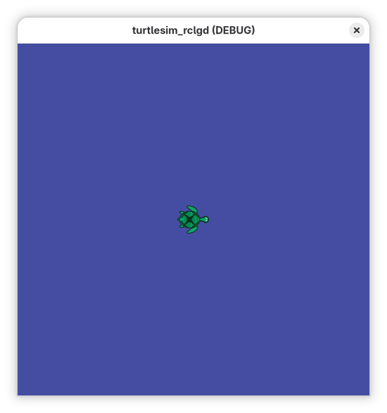

<div align="center">


# RCLGD

**A native ROS 2 client library for the Godot Engine**

[](https://github.com/Ozuba/rclgd/actions/workflows/jazzy.yaml)
[](https://github.com/Ozuba/rclgd/actions/workflows/kilted.yaml)
[](https://github.com/Ozuba/rclgd/actions/workflows/lyrical.yaml)
[](https://github.com/Ozuba/rclgd/actions/workflows/rolling.yaml)
<br>
[](https://rclgd.readthedocs.io/)
[](LICENSE)
[](https://doi.org/10.5281/zenodo.18440938)



</div>

rclgd runs rclcpp inside Godot as a GDExtension, built on
[ROS Babel Fish](https://github.com/LOEWE-emergenCITY/ros_babel_fish): no
rosbridge, no WebSockets, any message type at runtime. Nodes, topics,
services, actions, parameters, TF2, QoS, sim time and logging, all from
GDScript.

## Quick start

```bash
sudo apt install ros-jazzy-rclgd       # or build from source, below
ros2 rclgd create my_sim
colcon build --packages-select my_sim && source install/setup.bash
ros2 rclgd editor my_sim               # edit in Godot
ros2 run my_sim my_sim                 # run it like any ROS node
```

```gdscript
extends Node

var node: RosNode
var pub: RosPublisher
var timer: RosTimer  # keep a reference: dropping it cancels the timer

func _ready() -> void:
	node = RosNode.new()
	node.init("godot_talker")
	pub = node.create_publisher("/chatter", "std_msgs/msg/String")
	timer = node.create_timer(1.0, func():
		var msg := RosMsg.from_type("std_msgs/msg/String")
		msg.data = "Hello from Godot!"
		pub.publish(msg))
	node.get_logger().info("Talker started")
```

Topic, timer and action callbacks run on Godot's main thread. Service
callbacks and action goal callbacks run on a ROS thread: keep them off the
scene tree.

## Supported distros

| ROS 2 | Branch | Ubuntu | Install |
|---|---|---|---|
| Jazzy | `jazzy` | 24.04 | apt or source |
| Kilted | `kilted` | 24.04 | source |
| Lyrical | `lyrical` | 26.04 | source |
| Rolling | `rolling` | 26.04 | source |

All use Godot 4.7, downloaded and installed by the build. From source:

```bash
git clone -b <distro> --recurse-submodules https://github.com/Ozuba/rclgd.git src/rclgd
rosdep install --from-paths src --ignore-src -y
colcon build --packages-up-to rclgd
```

## Documentation

Tutorials, the class reference and the CLI guide are at
**[rclgd.readthedocs.io](https://rclgd.readthedocs.io/)**.

## Contributing

Issues and pull requests are welcome. Open pull requests against `rolling`;
changes are merged into the other distro branches. Run the tests with
`colcon test --packages-select rclgd`.

rclgd is MIT licensed. If you use it in research, please cite it via
[CITATION.cff](CITATION.cff).
