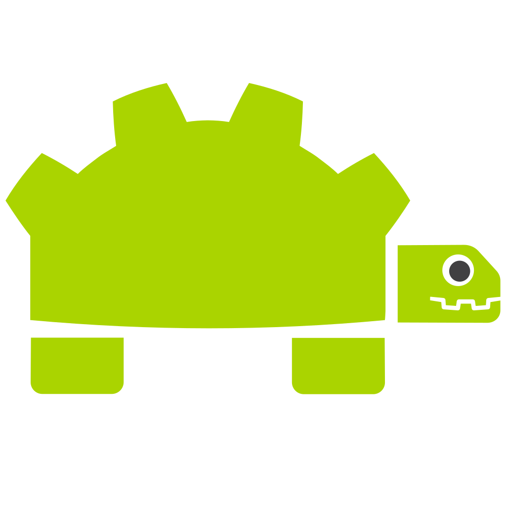

:allow_comments: False

rclgd Documentation
===================

Welcome to the documentation for **rclgd**, a native ROS 2 client library for
Godot Engine 4, developed and maintained by **Ozuba**.

rclgd runs ``rclcpp`` inside Godot as a GDExtension, so a Godot project is a
real ROS 2 node: no rosbridge, no WebSockets, no bridge process. It is built
for robot simulators, digital twins and operator interfaces.

- **Any message, no recompilation**: messages are handled at runtime through
  ``ros_babel_fish``; a sourced interface package just works.
- **Typed in GDScript**: every interface your ``package.xml`` depends on becomes
  a native class (``RosGeometryMsgsTwist``, ...) with autocompletion and type
  checking.
- **Complete API**: publishers, subscribers, timers, awaitable services and
  actions, parameters, QoS, TF2, simulation time and logging.
- **Native tooling**: Godot projects are colcon packages
  (``build_type: rclgd``), created, opened and diagnosed with
  ``ros2 rclgd``.

.. toctree::
   :hidden:
   :maxdepth: 2
   :caption: Getting Started
   :name: sec-get-started

   getting_started/installation
   getting_started/cli
   getting_started/introduction

.. toctree::
   :hidden:
   :maxdepth: 2
   :caption: Tutorials
   :name: sec-tutorials

   tutorials/basic_usage
   tutorials/make_rclgd_pkg
   tutorials/custom_messages
   tutorials/turtlesim_rclgd

.. toctree::
   :hidden:
   :maxdepth: 2
   :caption: Core Concepts
   :name: sec-concepts

   concepts/architecture
   concepts/transforms
   concepts/parameters_deep_dive

.. toctree::
   :hidden:
   :maxdepth: 1
   :caption: Class reference
   :name: sec-class-ref

   classes/index
